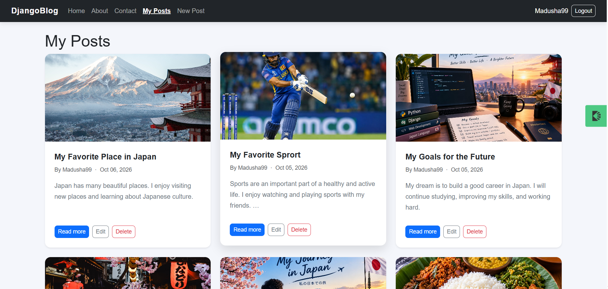

# DjangoBlog

DjangoBlog is a blog website built with Django.
Users can read published posts, create their own posts,
upload cover images, and manage their posts.

## Features

- View published blog posts
- Browse posts by category
- Pagination for blog posts
- User registration and login
- Create, edit, and delete posts
- Upload cover images
- View your own posts
- Password reset functionality
- About and Contact pages
- Custom 403, 404, and 500 error pages
- Responsive layout
- WhiteNoise for static files

## Technologies Used

- Python
- Django
- PostgreSQL
- HTML
- CSS
- Bootstrap
- WhiteNoise

## Setup Instructions

### 1. Clone the repository

```bash
git clone https://github.com/madushadilan99-lgtm/djangoblog.git
cd djangoblog
```

### 2. Create and activate a virtual environment

Windows PowerShell:

```powershell
python -m venv venv
.\venv\Scripts\Activate.ps1
```

### 3. Install dependencies

```bash
pip install -r requirements.txt
```

### 4. Configure environment variables

Create a `.env` file in the project root and configure the required environment variables.

Do not share your secret key or other private credentials.

### 5. Apply database migrations

```bash
python manage.py migrate
```

### 6. Start the development server

```bash
python manage.py runserver
```

Open the following address in your browser:

http://127.0.0.1:8000/

## Screenshots

### Home Page



## Project Status

This project was developed as a Django learning project.